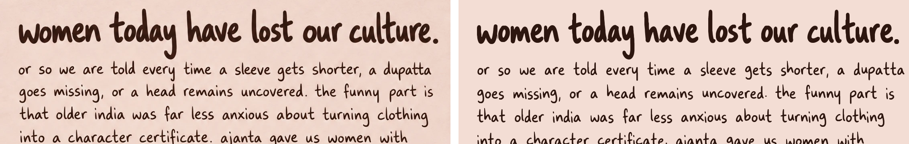

# font-from-image

A [Claude Code](https://claude.com/claude-code) skill that turns a picture of lettering into a
font, or finds the free font it already is.

Give Claude a photo of your handwriting, a scanned note, an AI-generated "handwritten" quote
card, a wordmark, or a screenshot of text, and it will:

1. **Check whether the lettering is a real font** (repeated letters identical?) and, if so,
   find the closest open-licensed match on Google Fonts by rendering candidates next to your
   image and comparing them letter by letter.
2. **Or build a font from the image**: segment every letter, pick the most typical instance of
   each, trace it, measure spacing from the image, compose the characters the image does not
   contain (capitals, digits, punctuation) from its own strokes, and write OTF / TTF / WOFF2
   with a specimen for comparison.

Everything runs locally. Nothing is uploaded.

## Install

Copy or symlink the `font-from-image/` folder into your skills directory:

```bash
git clone https://github.com/<you>/font-from-image
ln -s "$PWD/font-from-image/font-from-image" ~/.claude/skills/font-from-image
```

Then in Claude Code: *"here's a photo of my handwriting, make me a font"* or *"what font is
this?"* with an image attached. The skill creates a Python virtualenv the first time
(`scripts/setup.sh`): fonttools, potracer, numpy, scipy, pillow, scikit-image, brotli.

## What is in the skill

```
font-from-image/
├── SKILL.md                          workflow Claude follows
├── scripts/
│   ├── setup.sh                      virtualenv + dependencies
│   ├── prep.py                       photo/scan -> clean ink map (lighting, ruled lines, skew)
│   ├── glyph_consistency.py          font or hand? template-match repeated letters
│   ├── identify.py                   render Google Fonts candidates next to the image
│   ├── segment.py                    lines -> words -> letters, matched to a transcript
│   ├── pick_glyphs.py                best instance per character, baselines, x-heights
│   ├── synth_glyphs.py               compose missing characters from the hand's strokes
│   ├── build_font.py                 trace + assemble OTF/TTF/WOFF2 (fontTools, potrace)
│   └── specimen.py                   re-typeset the source text for side-by-side checking
└── references/
    ├── free-handwriting-fonts.md     curated candidate list with the tells to compare
    └── pipeline-details.md           internals and knobs for every stage
```

## Example

The skill was built on an Instagram quote card generated by an AI image model (so no font
existed). The result reproduces the body text within a few percent of the original and uses
the heading's own letters for a Bold weight:



## Limits

- Resolution: letters need to be at least ~20 px tall to trace cleanly. Prefer the original
  file over screenshots.
- A font made this way has no kerning or contextual alternates; every `a` is the same `a`.
- Composed characters (whatever the image lacks) are designs in the same pen, not copies.
- A font made from someone else's handwriting needs their permission.

## License

The skill (scripts and documentation) is MIT licensed. Fonts you build with it are yours; the
SIL Open Font License is a good choice if you want to share them.
